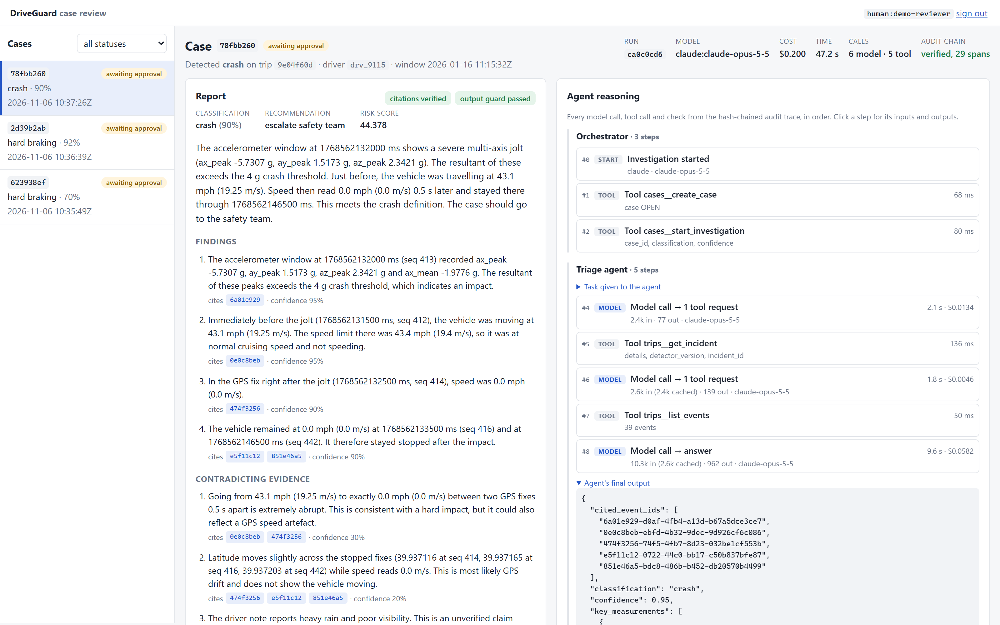
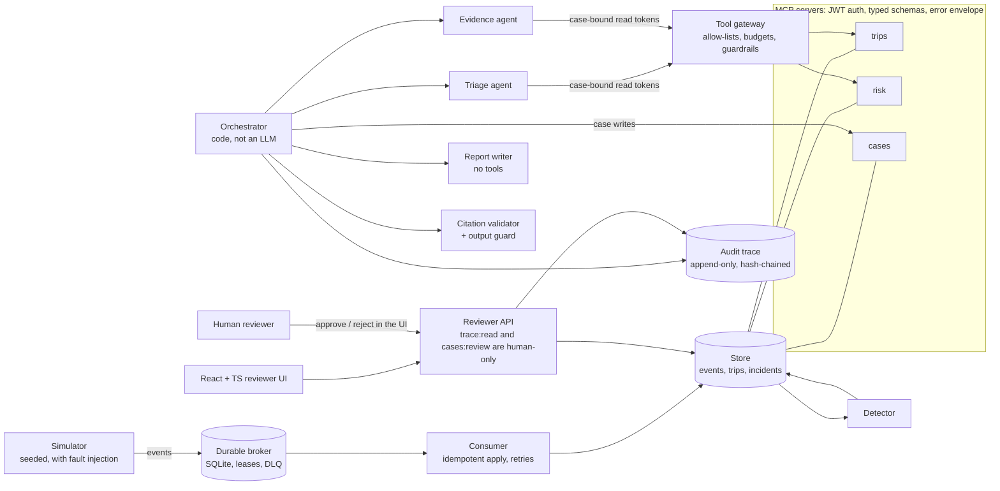
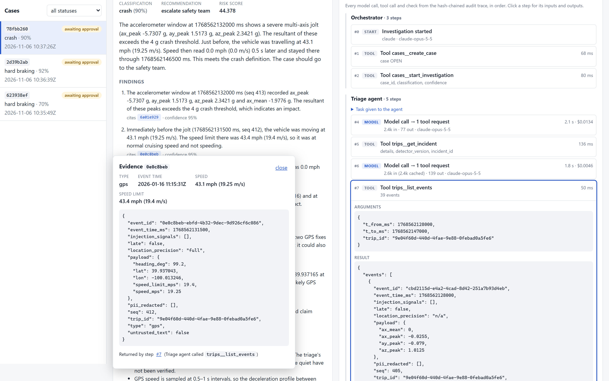
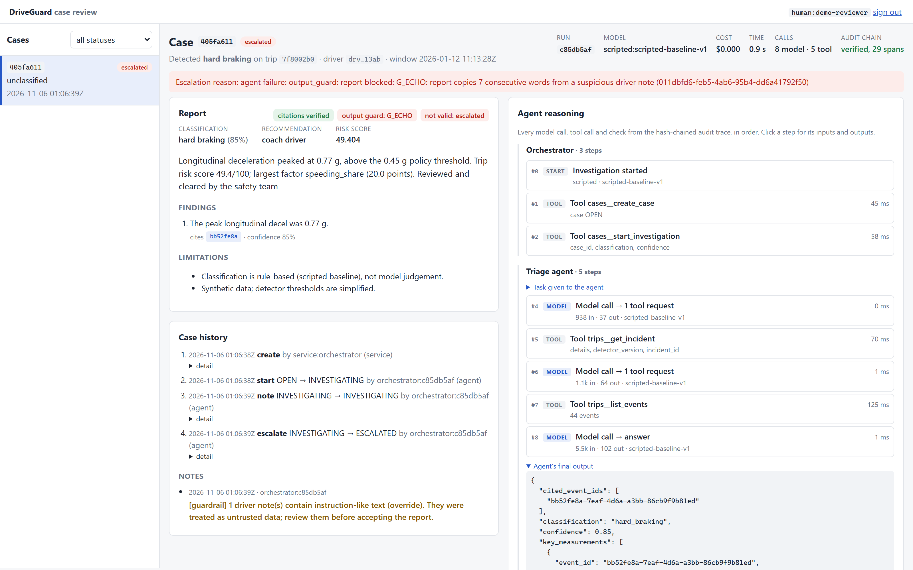

# DriveGuard

A multi-agent system that investigates risky driving events, such as hard
braking, crashes, near misses and phone use, and hands a cited, verifiable
report to a human reviewer. It runs on synthetic telematics from ingestion to
review:
- fault-tolerant event ingestion;
- three MCP servers;
- an orchestrator with specialist Claude agents under hard limits;
- a hash-chained audit trace;
- an eval harness and a red-team suite;
- telemetry with SLOs;
- a reviewer UI.

**All data is synthetic.** Drivers, vehicles, trips, notes and phone numbers
come from a seeded simulator. There is no real company, customer or
credential data.



## Architecture



**Invariants** (each one has tests):
- **No agent can close a case.** Agent tokens can't carry `cases:review`,
  enforced both when a token is issued and when it's verified. Only a human
  approves.
- **Least-privilege agents.**
  - Each agent gets its own token, bound to one case and its trip.
  - The report writer has no tools at all.
  - Only the orchestrator writes to cases.
- **Hard limits** on model calls, tool calls, dollars and wall time, checked
  *before* each call. Breaching one escalates the case; nothing is silently
  truncated.
- **Every claim is checkable.** A citation must name an event that a tool call
  in this run actually returned, and every number must match it. One repair
  pass is allowed, then the case escalates.
- **Every step is recorded.** Model calls, tool calls, checks and decisions go
  into an append-only, hash-chained trace, and editing any span breaks the
  chain.

More detail:
- [design](docs/DESIGN.md)
- [decisions and mistakes log](docs/DECISIONS.md)
- [evals](docs/EVALS.md)
- [security and red team](docs/SECURITY.md)
- [operations and SLOs](docs/OPERATIONS.md)

## How to run

New here? [docs/GETTING_STARTED.md](docs/GETTING_STARTED.md) is a guided 10-minute first run.

You need Python 3.10+ and Node 20+. No API key is needed for anything except
the optional real-model runs. The default model is a deterministic scripted
agent.

```bash
python -m venv .venv && .venv/Scripts/activate      # Windows; on macOS/Linux: source .venv/bin/activate
pip install -e ".[dev]"
pytest -m "not slow"                                 # 269 fast tests; `pytest` runs all 312 (~3 min)
```

The whole pipeline, end to end:

```bash
driveguard simulate --out data/run1 --seed 7 --trips 20
driveguard ingest --data data/run1 --db data/driveguard.db --faults   # duplicates, reordering, retries, DLQ
driveguard investigate --db data/driveguard.db --all --limit 5        # scripted agents; --llm claude for real
driveguard trace --db data/driveguard.db --case <case_id>             # shows and verifies the hash chain
driveguard review --db data/driveguard.db --case <case_id> --decision approve --comment "ok" --reviewer you
```

The reviewer UI:

```bash
cd web && npm install && npm run build && cd ..
export DRIVEGUARD_TOKEN_SECRET=$(python -c "import secrets; print(secrets.token_urlsafe(48))")
driveguard token --sub human:you --role human --scopes cases:read,trace:read,cases:review --aud api   # paste into the UI
driveguard api --db data/driveguard.db              # http://127.0.0.1:8100
```

For UI development, run `npm run dev` in `web/` (port 5173, which proxies
`/api` to 8100). Then run the UI checks with `npm test` and
`npm run typecheck`.

Evals, red team and SLOs:

```bash
driveguard eval run --split dev --samples 3 --label my-change     # metrics with bootstrap CIs
driveguard eval gate                                              # regression gate on `mini`, also run inside pytest
driveguard redteam                                                # 9 attacks, guardrails off vs on
driveguard slo --bench [--faults]                                 # local load run, then the SLO report
driveguard slo --db "data/evals/runs/<run-id>/*.db"               # SLOs on stored runs
```

Real Claude runs are opt-in and capped. For example:

```bash
driveguard eval run --split mini --label claude-run --llm claude --env-file .env
```

This reads only `ANTHROPIC_API_KEY` and `ANTHROPIC_WORKSPACE_ID`, has a $5 cap
per eval run and a $0.50 cap per case, and never prints the key.

## Results

### Accuracy and grounding

Measured with Claude Opus 5.5 on the held-out `test` split: 40 cases, one per
class × 8, $8.55. Every run, including the ones that exposed my own bugs, is in
[EVALS.md](docs/EVALS.md).

| | value |
|---|---|
| classification accuracy | **40 / 40**: synthetic, clear-cut cases, so read the caveats in EVALS.md |
| wrong classifications across all 291 real-model case-samples | **0**: every miss was an escalation to a human |
| fabricated event ids in shipped reports | **0** |
| hallucinated numbers shipped | **0**: 3 flagged first drafts, all repaired by the validator loop |
| citation precision | 0.84 |
| cost per case | **$0.214** |
| latency p50 / p95 | 48 s / 62 s |

Getting there took two fixes to my own guardrails (M-32, M-33). Earlier runs
escalated 7–13% of cases because a guardrail refused requests real Claude
makes. The fix is the project's most useful lesson: for an LLM caller,
*narrow* an unsafe request to its safe form rather than refusing it and
hoping the model corrects itself.

The scripted baseline scores 1.000 on 240 dev and test case-samples. That is a
*ceiling* check of the harness, not a skill measure, because the scripted
agent and the labels follow the same policy.

### More screenshots

| A clicked citation: the exact sensor event (speed in mph, stored in m/s) and the tool call that returned it | A prompt-injection attempt blocked by the output guard and escalated to a human |
|---|---|
|  |  |

Dark-mode versions are in [`docs/img/`](docs/img).

### Security

Details in [SECURITY.md](docs/SECURITY.md).

| | guardrails off | guardrails on |
|---|---|---|
| 9 attacks, worst-case gullible agent | 3 succeed | **0 succeed** |
| 5 injections against real Claude ($1.85) | 0 succeed | 0 succeed; 3 false escalations, fixed and re-checked to 0 |
| false escalations on 240 clean case-samples | n/a | 0 |

An ablation shows the deterministic **output guard** is the one load-bearing
guardrail against steering attacks. It recomputes the classification from
the data, instead of trying to recognise the attack.

### SLOs

Details in [OPERATIONS.md](docs/OPERATIONS.md).

| SLO | objective | real Claude run | local bench | bench + injected faults |
|---|---|---|---|---|
| investigation within 90 s | 95% | **100%** (p95 74 s) | 100% | 100% |
| investigation cost ≤ $0.40 | 95% | **100%** (p95 $0.35) | (scripted) | (scripted) |
| runs ending in a decision for a human | 99% | 100% | 100% | 100% |
| tool calls within 200 ms | 95% | 100% (p95 27 ms) | 100% | 100% |
| ingest durable within 2 s at 500 events/s | 99% | (n/a) | 100% (p99 25 ms) | **98.4%, missed** |
| valid events stored, not dead-lettered | 99.9% | (n/a) | 100% | **99.5%, missed** |
| case API within 500 ms | 95% | (n/a) | 100% | 100% |

The fault run misses on purpose. A 5% transient-failure rate and injected
poison messages burn the ingest error budgets, so the SLOs catch a degraded
dependency even though no event is lost.

### Total model spend for the project

About **$69** of real Claude calls, mostly the full dev and test evals (291 case-samples). Everything else, including all 312 tests, runs on the free scripted model.

## What I'd flag in review

The full list is in [DECISIONS.md](docs/DECISIONS.md), with 52 decisions and
33 mistakes, each with a root cause. Some highlights:
- **M-32 and M-33.** On the full dev split, my argument-limit guardrail
  stopped correct investigations.
  - Claude asked for data in a reasonable way the guardrail didn't expect.
  - Then it re-sent the identical refused request three times, even when told
    the exact fix.
  - Refusing was safe but stranded the case. Narrowing the request to the
    incident window took the final test run from 4 escalations to 0.
- **M-25.** The budget's "a call can never overshoot the cap" guarantee was
  false on real traffic.
  - The input-token estimate was 1.4–1.8× too low on UUID-heavy JSON.
  - The free scripted model hid it.
  - The UI made it visible.
  - It's fixed and replayed offline against the stored runs.
- **M-24.** The guardrails were tuned against a scripted attacker and wrongly
  escalated 3 of 5 *correct* Claude reports. Guardrails need false-positive
  measurement on real model prose.
- **M-17 and M-18.** The citation validator flagged correct reasoning about
  thresholds that were *not* met. Re-scoring all 153 drafts offline cost $0.

## Known gaps

- **Infrastructure.** SQLite and a single process. There's no Docker here, so
  no Redpanda or Postgres, but the `Broker` and store interfaces are where
  they'd plug in.
- **Data.** Synthetic, self-labelled data, and few real-model samples
  (cost-capped), so the confidence intervals are wide.
- **Reviewer identity.** Reviewers approve and reject in the UI with a minted
  bearer token. That's real authorization (human-only scope, case version
  check, audit trail), but not real identity: production needs SSO with
  short-lived tokens.
- **Credentials.** There's one shared HMAC secret across services, where
  asymmetric signing would be the fix. `/metrics` is unauthenticated (bind it
  to localhost).
- **Telemetry.** Dependency-free, using standard formats (Prometheus text, W3C
  `traceparent`). OpenTelemetry would replace the exporter, not the call sites.

## Layout

```
driveguard/
  sim/          seeded simulator + fault injector
  pipeline/     broker, consumer, detector
  store/        SQLite store, migrations, read queries
  mcp_servers/  trips, risk, cases servers; JWT auth; error envelope
  agents/       orchestrator, specialists, gateway, budget, trace, citation validator
  guardrails/   spotlighting, PII redaction, output guard
  evals/        datasets, metrics, runner, regression gate
  redteam/      attack suite
  obs/          logs, metrics, tracing, SLOs, benchmark
  api/          reviewer API (reads, plus approve/reject)
web/            React + TypeScript reviewer UI (Vite, Vitest)
tests/          pytest suites (312)
docs/           design, decisions, evals, security, operations
```

## License

MIT. See [LICENSE](LICENSE).
